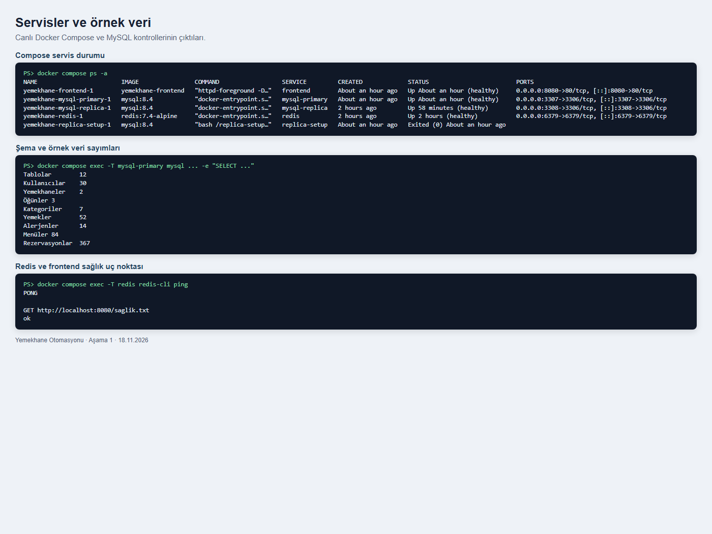
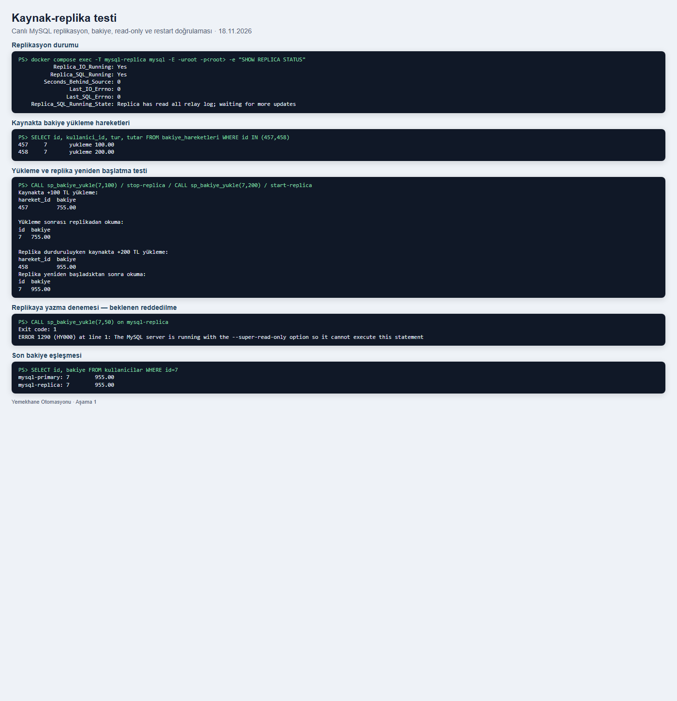

# Aşama 1 — Altyapı

**Tarih:** 18 Kasım 2026  
**Kapsam:** Başlangıç paketinin kurulması, servis sağlığı ve kaynak-replika doğrulaması.

## 1. Sistemi başlatma ve servisler

```powershell
docker compose up -d
docker compose ps -a
```

`docker compose ps -a` çıktısı: `mysql-primary`, `mysql-replica`, `redis` ve `frontend` `Up (healthy)`; tek seferlik `replica-setup` `Exited (0)` durumundadır.



## 2. Şema ve örnek veri

Başlangıç veritabanındaki tablolar ve örnek kayıtlar doğrulandı:

| Kontrol | Sonuç |
|---|---:|
| Tablolar | 12 |
| Kullanıcılar | 30 |
| Yemekhaneler | 2 |
| Öğünler | 3 |
| Yemek kategorileri | 7 |
| Yemekler | 52 |
| Alerjenler | 14 |
| Menüler | 84 |
| Rezervasyonlar | 367 |

## 3. Kaynak-replika doğrulaması

```powershell
docker compose exec -T mysql-replica mysql -uroot -pyemekhane_kok -e "SHOW REPLICA STATUS\G"
docker compose exec -T mysql-primary mysql -uyemekhane_app -pUyg_2026 yemekhane -e "CALL sp_bakiye_yukle(7, 100)"
docker compose exec -T mysql-replica mysql -uyemekhane_app -pUyg_2026 yemekhane -e "SELECT id, bakiye FROM kullanicilar WHERE id = 7"
docker compose exec -T mysql-replica mysql -uyemekhane_app -pUyg_2026 yemekhane -e "CALL sp_bakiye_yukle(7, 50)"
docker compose stop mysql-replica
docker compose exec -T mysql-primary mysql -uyemekhane_app -pUyg_2026 yemekhane -e "CALL sp_bakiye_yukle(7, 200)"
docker compose start mysql-replica
docker compose exec -T mysql-replica mysql -uyemekhane_app -pUyg_2026 yemekhane -e "SELECT id, bakiye FROM kullanicilar WHERE id = 7"
```

| Test | Gerçekleşen sonuç |
|---|---|
| Replikasyon | `Replica_IO_Running: Yes`, `Replica_SQL_Running: Yes`, `Seconds_Behind_Source: 0`; son I/O ve SQL hata kodları `0` |
| Kaynakta +100 TL yükleme | Hareket `457`; bakiye `755.00` |
| Yüklemeden sonra replika okuması | Kullanıcı `7`; bakiye `755.00` |
| Replikaya yazma denemesi | Beklenen `ERROR 1290`; replika `super-read-only` olduğu için reddedildi |
| Replika kapalıyken kaynakta +200 TL | Hareket `458`; kaynak sonucu `955.00` |
| Replika yeniden başladıktan sonra | Değişiklik replike oldu; kullanıcı `7` bakiyesi `955.00` |



## 4. Redis ve frontend sağlık kontrolü

```powershell
docker compose exec -T redis redis-cli ping
Invoke-WebRequest -UseBasicParsing http://localhost:8080/saglik.txt
```

Redis `PONG`, frontend sağlık uç noktası `ok` yanıtını verdi.

## Not

Doğrulama amacıyla başlangıç verisindeki kullanıcı `id=7` için toplam 300 TL bakiye yüklenmiştir. Mevcut kaynak ve replika bakiyesi `955.00` olarak eşleşir. Veritabanı sıfırlanmamış, `docker compose down -v` çalıştırılmamıştır. Ders başlangıç paketindeki test bağlantı bilgileri rapordaki komutlarda kullanılmıştır.
